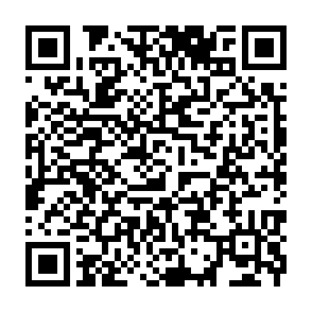

# Traccar Live for QField

A [QField](https://qfield.org) plugin that shows your [Traccar](https://www.traccar.org) GPS devices on the map — live — and saves their positions and tracks into your project's layers when you ask it to.

> **Not an official Traccar product.** Traccar Live is an independent, community-made plugin. It is not made, endorsed or supported by Traccar or its developers, and is not affiliated with them.
>
> [Traccar](https://www.traccar.org) is open-source GPS tracking software created by Anton Tananaev and its contributors. The Traccar name, the Traccar server, apps, API and documentation belong to their respective owners. This plugin only connects to a Traccar server that you have access to, using the interfaces Traccar publishes ([Traccar API](https://www.traccar.org/traccar-api/)). For Traccar itself (installation, apps and support), see [traccar.org](https://www.traccar.org).

- **One time window for everything** — *Last 15 minutes … Last 3 months*, custom dates, or the start/end of a feature such as an incident. The tracks on the map are the fixes inside the window, and the Save buttons save exactly that.
- **Live map overlay** — markers, name labels, GPS-accuracy circles and tracks, refreshed every few seconds. Nothing is written to your project until you tap Save.
- **Two layers, saved on demand** — positions and tracks, into any point / line layers you choose.
- **Geofences** — Traccar's areas, lines and circles on the map in their own colours; show / hide, recolour or delete them.
- **Add to Traccar from the field** — tap the map to send a point (device), an area, a line or a circle, or send a layer's features.
- **QFieldCloud-safe** — saves wait while a cloud sync is running, then go ahead.
- **Local time everywhere** on screen, including summer time; stored in UTC.

Latest release: **[v0.6](https://github.com/TyHol/Traccar_QField/releases/latest)** · Changes: [CHANGES.md](CHANGES.md)

---

## Install


**From a link** — in QField open **Settings → Plugins → Install plugin from URL** and paste:

```
https://github.com/TyHol/Traccar_QField/releases/download/v0.6/traccar_qfield-v0.6.zip
```

**From a file** — download `traccar_qfield-v0.6.zip` from the [release page](https://github.com/TyHol/Traccar_QField/releases/latest) and unzip it into QField's `plugins/traccar_qfield` folder (on Windows: `Documents\QField Documents\QField\plugins\`).

Requires a Traccar account (your own server or e.g. `https://server.traccar.org`) and QField 3.3 or later.

## Getting started

1. Tap the **Traccar** button on the QField toolbar.
2. **Settings (cog) → Connection** — enter the server address (the one you open in a browser), your Traccar email / username and password, and tap *Test connection*.
3. Pick a **Time window** and tap **Live** to follow devices, or **Refresh** to load the window once.
4. To keep what you see, choose layers in **Settings (cog) → Layers** and use **Save positions** / **Save tracks**.

To hide the Traccar button from the map, turn off **Show button on the map** in **Settings (cog) → Advanced**, or tap the settings icon next to *Traccar Live* in QField's **Plugins** list and turn off **Show icon on canvas**. Live tracking keeps running. With the button hidden, open the plugin from that Plugins-list screen: it has an **Open Traccar Live** button.

Not sure which layers to use? Add the two layers from [`traccar_template.gpkg`](traccar_template.gpkg) (also attached to each release) to your QGIS project — they have every field the plugin fills.

## Using it

### Time window
| Choice | What you get |
|---|---|
| Last 15 min … Last 3 months | Follows the current time. With Live on, new fixes are added and old ones drop off. |
| Custom dates… | From / To in local time (`YYYY-MM-DD HH:MM`), then *Show this window*. |
| From feature… | The start/end of a feature, e.g. an incident: start → end, start + duration, or end − duration. Set the layer up once in Settings (cog) → Advanced. |

Each device in the list shows how many fixes it has in the window and their time span. A window that ends in the past cannot change, so Live pauses for it and the markers show each device's last fix in that window.

### Main screen
- **Live / Stop live** — refresh every few seconds (10 s by default).
- **Refresh** — load the window once. **Clear** — stop Live and remove everything from the map.
- **Show** — switch Markers, Labels, Tracks and Geofences on or off (GPS accuracy circles: Settings → Advanced).
- **Add** (next to Clear) — Point, Area, Line, Circle or From layer…, described below.
- **Devices** — each row shows the latest position (lat/long, degrees + minutes, Irish Grid, UK Grid or the project CRS — Settings (cog) → Advanced); the copy button copies it to the clipboard and the target button centres the map on that device. Untick a device to hide it from the map and leave it out of the Save buttons (remembered); the tick by *Devices* shows or hides them all. Each device has its own colour (the same as in the QGIS plugin); markers and tracks turn grey when the last fix is older than the limit (10 min by default). Tap a marker on the map for its name, fix age, speed and battery.
- **Geofences** — Traccar's geofences, each in its own colour (never grey). Untick one to hide it (remembered); tap its colour to change it (saved in Traccar); the pencil edits it with the same form as Add; the target centres the map on it; the bin deletes it from Traccar after asking. *Geofences* under Show switches them all off.
- **Devices / Geofences tabs** — **⋮** on each tab chooses which details its list shows (fixes and time span, speed, battery, location · type, made in, speed limit, description).
- **Add** — *Point*: tap the map (or *My location*) and give a name; a new name adds a device in Traccar (with its identifier, category, group, phone, model and contact if you fill them in), an existing device's name moves it there. *Area* / *Line*: tap each corner, then *Done*. *Circle*: tap the centre, choose a radius. *From layer…*: send a layer's features (all or one), named — and described — from fields. Geofences get a description, speed limit, corridor width (lines), calendar and the colour you pick; one sent before with the same name is replaced. Points added this way have a bin in the device list. The QGIS plugin has the same tools and form.
- **Save positions** / **Save tracks** — the line underneath shows where they go; tap it to change.

### Saving
| Button | Option (Settings (cog) → Layers) | Adds |
|---|---|---|
| Save positions | *Latest fix per device* | one point per ticked device |
| | *Every fix in the time window* | one point per fix |
| Save tracks | *Add a new track each save* | one line per device |
| | *Keep only the most recent track* | replaces that device's earlier track (matched by `device_id`, or by the device-name field if there is no `device_id`) |

Tracks carry altitude as Z and the fix time as M when the layer has them; plain 2D layers work too.

### Fields
Fields are filled **by name** — whichever of these your layer has; others are left alone.

| Positions layer | | Tracks layer | |
|---|---|---|---|
| `device_id` | Traccar device id | `device_id` | Traccar device id |
| `name` | device name | `name` | device name |
| `status` | online / offline | `start_time` | first fix (UTC) |
| `fix_time` | GPS fix time (UTC) | `last_update` | last fix (UTC) |
| `fix_local` | fix time as local text | `start_local`, `last_local` | the same as local text |
| `speed_kmh`, `course` | speed, heading | `from_time`, `to_time` | the time window |
| `altitude_m`, `accuracy_m` | altitude, GPS accuracy | `n_points` | number of fixes |
| `battery`, `motion`, `address` | from the device | `saved_at` | when you saved |
| `fetched_at` | when you saved | | |

Two extras in **Settings (cog) → Layers / Tag**:
- **Device name goes into** — also write the device name into another text field, e.g. `title` on QField's built-in layers (only text fields are offered).
- **Tag** — stamp a text such as `FIRE-2026-001` into a field of your choice on everything you save. With *From feature*, the feature's display value can be used as the tag instead.

### Times
Everything on screen is local time, with the right summer/winter offset for each date. Date/time fields are stored in **UTC**: QField forms show them in local time, QGIS desktop shows UTC. For local time in QGIS use the `*_local` text fields, or the expression `datetime_from_epoch(epoch("fix_time"))`.

### QFieldCloud
In a cloud project, a save made while QFieldCloud is syncing waits ("⏳ Waiting for QFieldCloud sync…") and runs as soon as the sync finishes (cancelled after 10 minutes). The live overlay never writes to the project, so it never creates changes to sync.

## Settings
Settings are a list of short pages; changes apply immediately.

| Page | Contains |
|---|---|
| **Connection** | Server URL, email / username, password, *Test connection*, *Send points to* (Traccar's OsmAnd address; blank = port 5055 on the server) |
| **Layers** | Positions layer, device-name field, latest / every fix · Tracks layer, device-name field, add / keep most recent |
| **Tag** | On/off, tag text, field, use the feature's display value |
| **Advanced** | Map button, location format (lat/long, degrees + minutes, Irish Grid, UK Grid, project CRS), refresh interval, grey-marker limit, the layer and fields used by *From feature* |

The password is stored in QField's settings on the device, like other plugin settings.

## Troubleshooting
| Message | What to check |
|---|---|
| *HTTP 401 — wrong username/password* | Settings (cog) → Connection; use the same login as the Traccar web page. |
| *No response — check server URL* | The address (including `https://`) and the phone's connection. |
| *No fixes in this window* | The device list shows each device's fixes and span — pick a longer window or check the device's clock. |
| *… layer did not accept …* | The layer must be editable and of the right type (points for positions, lines for tracks). |
| Nothing saved during a sync | Expected — it saves when QFieldCloud finishes. |
| *Send point: no response* | Traccar's OsmAnd port (5055) must be reachable from the phone; set *Send points to* if it differs. |
| *Couldn't add … to Traccar* / *HTTP 403* | Your Traccar account isn't allowed to add devices or geofences — ask the server's admin. |

## Development
- Everything is in [`main.qml`](main.qml); [`metadata.txt`](metadata.txt) holds the version.
- [`tools/make_template_gpkg.py`](tools/make_template_gpkg.py) rebuilds `traccar_template.gpkg` (plain Python, no GDAL needed).
- [`tests/qml`](tests/qml) runs `main.qml` outside QField — stand-in QField modules, a test driver and a fake Traccar server — and fails on any check or QML warning:
  ```
  pip install PySide6-Essentials
  python tests/qml/run_tests.py
  ```
- A plugin release zip contains `main.qml`, `metadata.txt`, `traccar_icon.svg` and the `icons/` folder at its root.
- Name the zip `traccar_qfield-vX.Y.zip` (hyphen before the version). QField names the install folder after the zip and only strips a `-vX.Y` suffix, so any other name installs each version as a separate plugin instead of updating it.

A companion QGIS desktop plugin, [Traccar_QGIS](https://github.com/TyHol/Traccar_QGIS), uses the same layers and fields, so one GeoPackage works in both.

## Credits
By [TyHol](https://github.com/TyHol). Uses the [Traccar API](https://www.traccar.org/traccar-api/). Overlay feature inspired by OPENGIS.ch's [qfield-traccar](https://github.com/opengisch/qfield-traccar) plugin.

Traccar — the GPS tracking server, apps, API and protocols this plugin works with — is created by Anton Tananaev and the Traccar contributors ([traccar.org](https://www.traccar.org), [GitHub](https://github.com/traccar/traccar)). All credit for Traccar goes to them; this plugin is not affiliated with or endorsed by Traccar.

The icons in [`icons/`](icons) are Google's [Material Icons](https://fonts.google.com/icons), used under the [Apache License 2.0](icons/LICENSE-Apache-2.0.txt).

## Licence
Copyright © 2026 TyHol. Released under the [GNU General Public License v2.0 or later](LICENSE) (GPL-2.0-or-later), the same licence as QField and QGIS.
