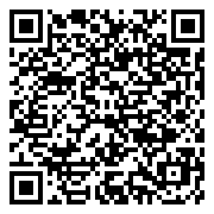

# Traccar Live for QField

A [QField](https://qfield.org) plugin that shows your [Traccar](https://www.traccar.org) GPS devices on the map — live — and saves their positions and tracks into your project's layers when you ask it to.

- **One time window for everything** — *Last 15 minutes … Last 3 months*, custom dates, or the start/end of a feature such as an incident. The tracks on the map are the fixes inside the window, and the Save buttons save exactly that.
- **Live map overlay** — markers, name labels, GPS-accuracy circles and tracks, refreshed every few seconds. Nothing is written to your project until you tap Save.
- **Two layers, saved on demand** — positions and tracks, into any point / line layers you choose.
- **QFieldCloud-safe** — saves wait while a cloud sync is running, then go ahead.
- **Local time everywhere** on screen, including summer time; stored in UTC.

Latest release: **[v0.5](https://github.com/TyHol/Traccar_QField/releases/latest)** · Changes: [CHANGES.md](CHANGES.md)

---

## Install


**From a link** — in QField open **Settings → Plugins → Install plugin from URL** and paste:

```
https://github.com/TyHol/Traccar_QField/releases/download/v0.5/traccar_qfield-v0.5.zip
```

**From a file** — download `traccar_qfield-v0.5.zip` from the [release page](https://github.com/TyHol/Traccar_QField/releases/latest) and unzip it into QField's `plugins/traccar_qfield` folder (on Windows: `Documents\QField Documents\QField\plugins\`).

**Upgrading from v0.4.1 or earlier, installed from a link?** Older zips were named without a hyphen, so QField kept each version as a separate plugin. Uninstall the old *Traccar Live* in QField's Plugins list, then install v0.5. From v0.5 on, new versions replace the installed one.

Requires a Traccar account (your own server or e.g. `https://server.traccar.org`) and QField 3.3 or later.

## Getting started

1. Tap the **Traccar** button on the QField toolbar.
2. **Settings (spanner) → Connection** — enter the server address (the one you open in a browser), your Traccar email / username and password, and tap *Test connection*.
3. Pick a **Time window** and tap **Live** to follow devices, or **Refresh** to load the window once.
4. To keep what you see, choose layers in **Settings (spanner) → Layers** and use **Save positions** / **Save tracks**.

To hide the Traccar button from the map, open QField's **Plugins** list, tap the settings icon next to *Traccar Live* and turn off **Show icon on canvas**. Live tracking keeps running, and the same screen has an **Open Traccar Live** button.

Not sure which layers to use? Add the two layers from [`traccar_template.gpkg`](traccar_template.gpkg) (also attached to each release) to your QGIS project — they have every field the plugin fills.

## Using it

### Time window
| Choice | What you get |
|---|---|
| Last 15 min … Last 3 months | Follows the current time. With Live on, new fixes are added and old ones drop off. |
| Custom dates… | From / To in local time (`YYYY-MM-DD HH:MM`), then *Show this window*. |
| From feature… | The start/end of a feature, e.g. an incident: start → end, start + duration, or end − duration. Set the layer up once in Settings (spanner) → Advanced. |

Each device in the list shows how many fixes it has in the window and their time span. A window that ends in the past cannot change, so Live pauses for it and the markers show each device's last fix in that window.

### Main screen
- **Live / Stop live** — refresh every few seconds (10 s by default).
- **Refresh** — load the window once. **Clear** — stop Live and remove everything from the map.
- **Show** — switch Markers, Labels, Tracks and Accuracy circles on or off.
- **Devices** — each row shows the latest position as lat/long; the copy button copies it to the clipboard and the target button centres the map on that device. Markers are blue when the last fix is recent and grey when it is older than the limit (10 min by default). Tap a marker on the map for its name, fix age, speed and battery.
- **Save positions** / **Save tracks** — the line underneath shows where they go; tap it to change.

### Saving
| Button | Option (Settings (spanner) → Layers) | Adds |
|---|---|---|
| Save positions | *Latest fix per device* | one point per device |
| | *Every fix in the time window* | one point per fix |
| Save tracks | *Add a new track each save* | one line per device |
| | *Keep only the most recent track* | replaces that device's earlier track (matched by `device_id`, or by the device-name field if there is no `device_id`) |

Tracks carry altitude as Z and the fix time as M when the layer has them; plain 2D layers work too.

### Fields
Fields are filled **by name** — whichever of these your layer has; others are left alone.

| Positions layer | | Tracks layer | |
|---|---|---|---|
| `device_id` | Traccar device id | `device_id` | Traccar device id |
| `name` | device name | `name` | device name |
| `status` | online / offline | `start_time` | first fix (UTC) |
| `fix_time` | GPS fix time (UTC) | `last_update` | last fix (UTC) |
| `fix_local` | fix time as local text | `start_local`, `last_local` | the same as local text |
| `speed_kmh`, `course` | speed, heading | `from_time`, `to_time` | the time window |
| `altitude_m`, `accuracy_m` | altitude, GPS accuracy | `n_points` | number of fixes |
| `battery`, `motion`, `address` | from the device | `saved_at` | when you saved |
| `fetched_at` | when you saved | | |

Two extras in **Settings (spanner) → Layers / Tag**:
- **Device name goes into** — also write the device name into another text field, e.g. `title` on QField's built-in layers (only text fields are offered).
- **Tag** — stamp a text such as `FIRE-2026-001` into a field of your choice on everything you save. With *From feature*, the feature's display value can be used as the tag instead.

### Times
Everything on screen is local time, with the right summer/winter offset for each date. Date/time fields are stored in **UTC**: QField forms show them in local time, QGIS desktop shows UTC. For local time in QGIS use the `*_local` text fields, or the expression `datetime_from_epoch(epoch("fix_time"))`.

### QFieldCloud
In a cloud project, a save made while QFieldCloud is syncing waits ("⏳ Waiting for QFieldCloud sync…") and runs as soon as the sync finishes (cancelled after 10 minutes). The live overlay never writes to the project, so it never creates changes to sync.

## Settings
Settings are a list of short pages; changes apply immediately.

| Page | Contains |
|---|---|
| **Connection** | Server URL, email / username, password, *Test connection* |
| **Layers** | Positions layer, device-name field, latest / every fix · Tracks layer, device-name field, add / keep most recent |
| **Tag** | On/off, tag text, field, use the feature's display value |
| **Advanced** | Refresh interval, grey-marker limit, the layer and fields used by *From feature* |

The password is stored in QField's settings on the device, like other plugin settings.

## Troubleshooting
| Message | What to check |
|---|---|
| *HTTP 401 — wrong username/password* | Settings (spanner) → Connection; use the same login as the Traccar web page. |
| *No response — check server URL* | The address (including `https://`) and the phone's connection. |
| *No fixes in this window* | The device list shows each device's fixes and span — pick a longer window or check the device's clock. |
| *… layer did not accept …* | The layer must be editable and of the right type (points for positions, lines for tracks). |
| Nothing saved during a sync | Expected — it saves when QFieldCloud finishes. |

## Development
- Everything is in [`main.qml`](main.qml); [`metadata.txt`](metadata.txt) holds the version.
- [`tools/make_template_gpkg.py`](tools/make_template_gpkg.py) rebuilds `traccar_template.gpkg` (plain Python, no GDAL needed).
- [`tests/qml`](tests/qml) runs `main.qml` outside QField — stand-in QField modules, a test driver and a fake Traccar server — and fails on any check or QML warning:
  ```
  pip install PySide6-Essentials
  python tests/qml/run_tests.py
  ```
- A plugin release zip contains `main.qml`, `metadata.txt`, `traccar_icon.svg` and the `icons/` folder at its root.
- Name the zip `traccar_qfield-vX.Y.zip` (hyphen before the version). QField names the install folder after the zip and only strips a `-vX.Y` suffix, so any other name installs each version as a separate plugin instead of updating it.

A companion QGIS desktop plugin, [Traccar_QGIS](https://github.com/TyHol/Traccar_QGIS), uses the same layers and fields, so one GeoPackage works in both.

## Credits
By [TyHol](https://github.com/TyHol). Uses the [Traccar API](https://www.traccar.org/traccar-api/). Overlay feature inspired by OPENGIS.ch's [qfield-traccar](https://github.com/opengisch/qfield-traccar) plugin.

## Licence
Copyright © 2026 TyHol. Released under the [GNU General Public License v2.0 or later](LICENSE) (GPL-2.0-or-later), the same licence as QField and QGIS.
